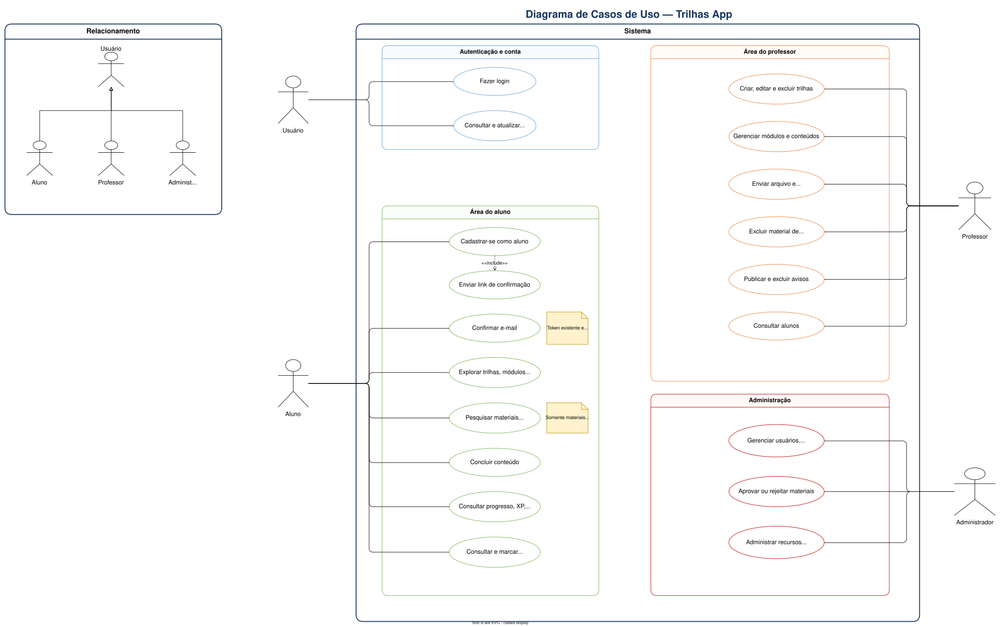
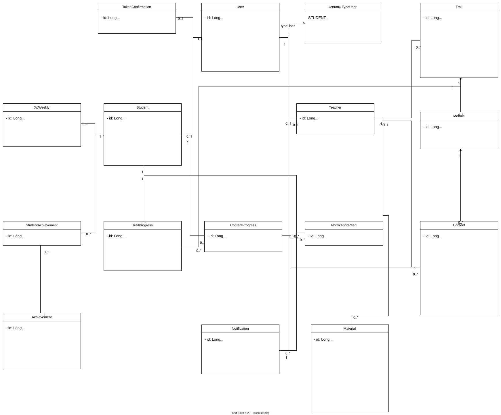
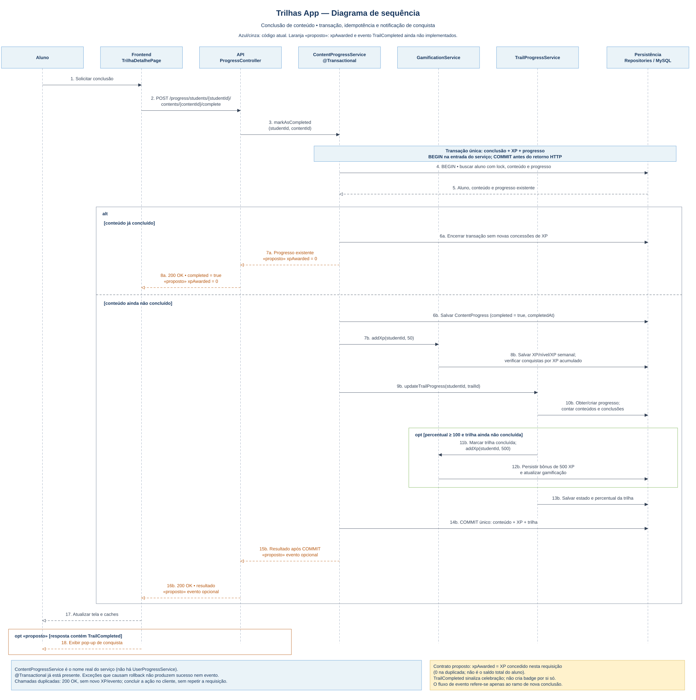
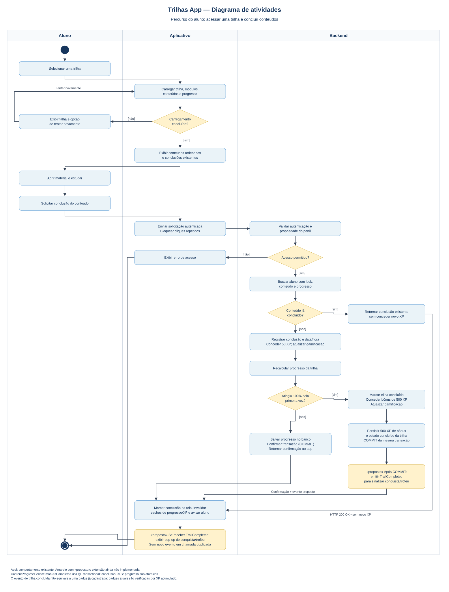

# 📚 Documentação - Trilhas App

Este repositório contém toda a documentação técnica, modelagem de banco de dados e artefatos de Engenharia de Software da plataforma educacional baseada em Trilhas de Aprendizagem, Conteúdos Curados, Comunicação e Gamificação.

---

## 🗂️ Estrutura do Repositório

```text
.
<<<<<<< HEAD
├── banco-dados/               # Modelos e imagens PNG históricos
└── docs/
    ├── arquitetura/           # Documentação de arquitetura e gamificação
    ├── database/              # MER, DER, imagens SVG e script SQL
    └── eng-software/          # Diagramas editáveis Draw.io e imagens SVG
```

## Diagramas de engenharia de software

As imagens em SVG podem ser ampliadas sem perda de qualidade. Os arquivos Draw.io permitem editar os diagramas.

### Casos de uso



[Imagem SVG](docs/eng-software/useCase-Trilhas.svg) · [Arquivo editável](docs/eng-software/useCaseTrilhas-App.drawio)

### Classes



[Imagem SVG](docs/eng-software/classeTrilhas-App.svg) · [Arquivo editável](docs/eng-software/classeTrilhas-App.drawio)

### Sequência



[Imagem SVG](docs/eng-software/sequenciaTrilhas-App.svg) · [Arquivo editável](docs/eng-software/sequenciaTrilhas-App.drawio)

### Atividades



[Imagem SVG](docs/eng-software/atividadesTrilhas-App.svg) · [Arquivo editável](docs/eng-software/atividadesTrilhas-App.drawio)

## Diagramas de banco de dados

O [documento de arquitetura do banco de dados](docs/arquitetura/ARQUITETURA_BANCO_DE_DADOS.md#diagramas-do-projeto) apresenta as imagens vetoriais do MER e do DER, com links para os modelos editáveis e observações sobre a modelagem histórica.
=======
├── banco-dados/
│   ├── modelo-conceitual/      # Arquivos e imagens do MER (brModelo)
│   ├── modelo-logico/         # Arquivos e imagens do DER (MySQL Workbench)
│   └── scripts/                # Scripts SQL (DDL e DML de testes)
│
├── eng-software/
│   ├── casos-de-uso/           # Diagrama de Casos de Uso e documentação
│   ├── classes/                # Diagrama de Classes
>>>>>>> bb24ef25dac29fc601e461b86deaf6af7c0d3281
