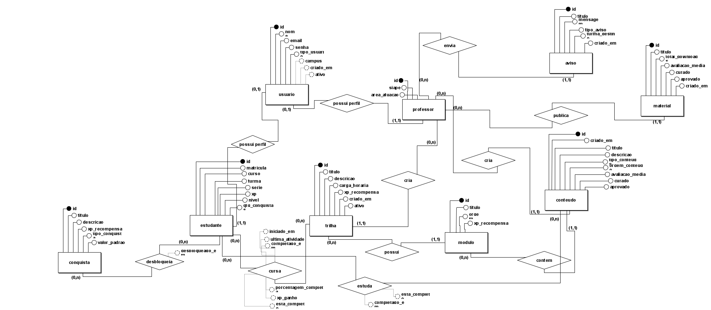
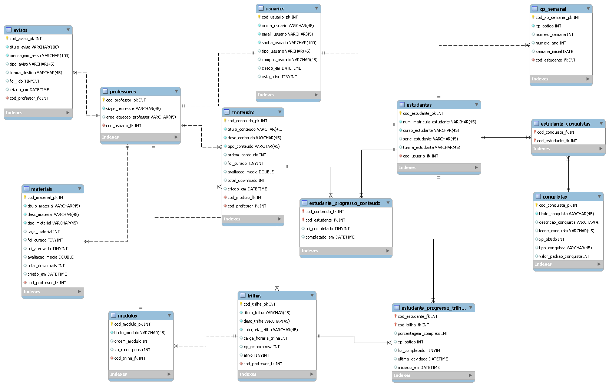
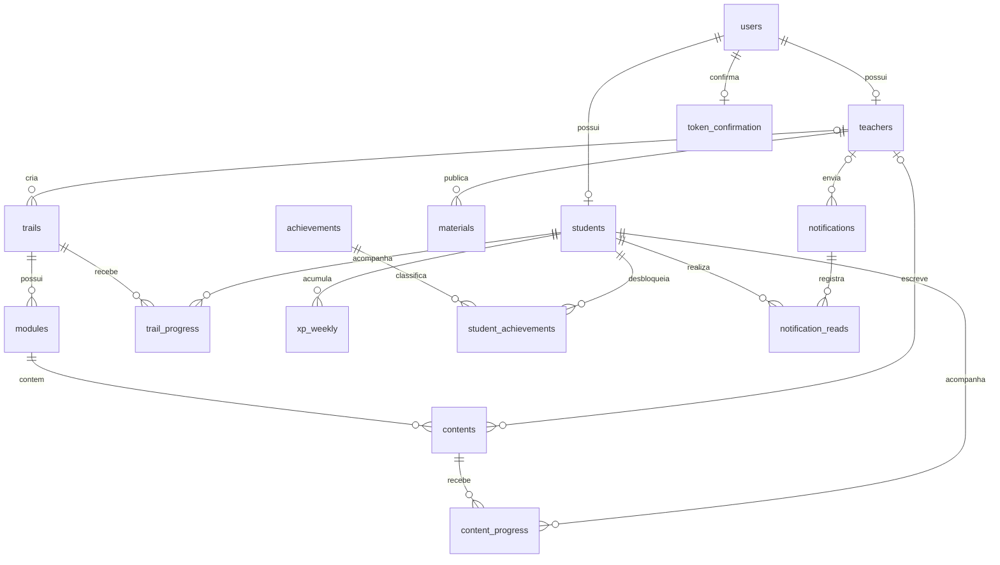

# Arquitetura do banco de dados

O Trilhas utiliza MySQL como banco relacional. O schema atende autenticação local, perfis acadêmicos, trilhas de aprendizagem, materiais, progresso, gamificação, notificações e confirmação de e-mail.

## Fontes de verdade

A ordem de precedência para compreender ou alterar o schema é:

1. migrations Flyway em `trilhas-backend/src/main/resources/db/migration`;
2. mapeamentos JPA em `trilhas-backend/src/main/java/com/ifpr/trilhas/models`;
3. este documento e os diagramas de apoio em `docs/database`.

Flyway é a fonte oficial nos ambientes `dev` e `prod`. O Hibernate usa `ddl-auto=validate` nesses perfis e deve apenas conferir se as entidades são compatíveis com o schema criado pelas migrations.

Os arquivos `trilhasDER.*` e `trilhasMER.*` registram etapas anteriores da modelagem. Eles ainda usam alguns nomes antigos em português e não representam integralmente as migrations V1 a V15. Portanto, devem ser tratados como material histórico até serem regenerados.

## Diagramas do projeto

### Modelo entidade-relacionamento (MER)

O MER apresenta a visão conceitual dos elementos do domínio e de seus relacionamentos.



Arquivos: [imagem SVG](../database/trilhasMER.svg) · [modelo editável BR Modelo](../database/trilhasMER.brM3)

### Diagrama entidade-relacionamento (DER)

O DER apresenta a modelagem relacional elaborada no MySQL Workbench, incluindo tabelas, atributos e ligações.



Arquivos: [imagem SVG](../database/trilhasDER.svg) · [modelo editável MySQL Workbench](../database/trilhasDER.mwb)

Os diagramas preservam o histórico da modelagem acadêmica. Para implementar ou revisar o banco executável, prevalecem as migrations Flyway e o catálogo atualizado deste documento.

## Visão por domínio

| Domínio | Tabelas | Responsabilidade |
| --- | --- | --- |
| Identidade | `users`, `students`, `teachers` | Credenciais locais, papel e dados específicos de estudantes e professores |
| Aprendizagem | `trails`, `modules`, `contents`, `materials` | Estrutura das trilhas, autoria e materiais complementares |
| Gamificação | `achievements`, `student_achievements`, `xp_weekly` | Catálogo de conquistas, desbloqueios e histórico semanal de XP |
| Progresso | `trail_progress`, `content_progress` | Estado individual do estudante em trilhas e conteúdos |
| Comunicação | `notifications`, `notification_reads` | Avisos gerais ou por turma e registro individual de leitura |
| Confirmação | `token_confirmation` | Token temporário e exclusivo para confirmação de e-mail |

## Relacionamentos principais



As relações com professor são opcionais em `trails.teacher_id`, `contents.author_id` e `notifications.author_id`. Em `materials.author_id`, a autoria é obrigatória.

## Catálogo de tabelas e migrations

| Versão | Tabela | Chave ou relação central |
| --- | --- | --- |
| V1 | `users` | `email` único; contém credencial, papel e estado da conta |
| V2 | `students` | relação 1:1 por `user_id`; `registration` única; coluna `version` para concorrência otimista |
| V3 | `teachers` | relação 1:1 por `user_id`; `siape` único |
| V4 | `trails` | autoria opcional por `teacher_id` |
| V5 | `modules` | pertence obrigatoriamente a uma trilha |
| V6 | `contents` | pertence a um módulo; autoria do professor é opcional |
| V7 | `materials` | autoria do professor é obrigatória |
| V8 | `achievements` | define tipo, valor-alvo e recompensa em XP |
| V9 | `student_achievements` | associação única entre estudante e conquista |
| V10 | `xp_weekly` | um registro por estudante, semana e ano |
| V11 | `trail_progress` | um registro por estudante e trilha |
| V12 | `content_progress` | um registro por estudante e conteúdo |
| V13 | `notifications` | autoria opcional e destino opcional por turma |
| V14 | `token_confirmation` | `token` e `user_id` únicos |
| V15 | `notification_reads` | uma leitura por notificação e estudante |

## Integridade e unicidade

As principais invariantes protegidas pelo banco são:

- `users.email`, `students.registration` e `teachers.siape` não podem se repetir;
- um usuário pode estar ligado no máximo a um registro de estudante e a um de professor;
- um estudante não recebe a mesma conquista duas vezes;
- só existe um progresso por par estudante–trilha e estudante–conteúdo;
- só existe um total semanal por estudante, número da semana e ano;
- uma notificação só pode ser marcada como lida uma vez por estudante;
- cada usuário possui no máximo um token de confirmação ativo na tabela.

`students.version` é mapeada com `@Version` pelo JPA e oferece bloqueio otimista nas atualizações do estudante. As constraints únicas de progresso complementam as transações da camada de services e ajudam a impedir duplicação de conclusão ou XP.

Os enums de usuário, conteúdo, material, notificação e conquista são persistidos como texto. Renomear um valor de enum exige avaliar os registros existentes e, quando necessário, criar uma migration de dados.

## Exclusão e ciclo de vida

Somente as chaves estrangeiras de `notification_reads` declaram `ON DELETE CASCADE`, tanto para notificações quanto para estudantes.

As demais relações usam o comportamento padrão do MySQL. Assim, registros referenciados normalmente não podem ser apagados sem que as dependências sejam removidas ou tratadas antes pela aplicação. Cascades configurados no JPA não substituem constraints ausentes no schema para operações executadas fora do Hibernate.

Arquivos enviados não são armazenados como BLOB. `contents.file_path` e `materials.file_path` guardam apenas o caminho; o arquivo físico fica no diretório configurado por `app.materials.upload-dir`.

## Índices

Chaves primárias e constraints `UNIQUE` criam os índices correspondentes no MySQL. A migration V10 também declara explicitamente `idx_xp_weekly_student_year` sobre `xp_weekly(student_id, year)` para consultas de histórico e ranking por período.

Novos índices devem partir de consultas reais observadas nos repositories ou em métricas do banco. Todo índice adicional deve ser criado por migration e avaliado quanto ao custo de escrita.

## Datas, horário e codificação

Datas com horário usam `DATETIME(6)` e datas semanais usam `DATE`. A URL JDBC configura `serverTimezone=UTC`, mas `DATETIME` não armazena informação de fuso horário; a aplicação deve manter uma convenção única ao gravar e apresentar esses valores.

O schema local deve ser criado com `utf8mb4` e uma collation compatível, como `utf8mb4_unicode_ci`. As migrations atuais não fixam charset ou collation por tabela, portanto essa configuração é responsabilidade da criação do database e do ambiente MySQL.

## Ambientes

| Perfil | Schema | Criação e evolução |
| --- | --- | --- |
| `dev` | `trilhas_dev` por padrão | Flyway executa V1–V15; Hibernate valida; baseline legado está habilitado |
| `test` | `trilhas_test` por padrão | Hibernate usa `create-drop`; Flyway fica desabilitado; `DataSeeder` popula dados demonstrativos |
| `prod` | definido por `DB_URL_PROD` | Flyway executa migrations; Hibernate valida; baseline automático fica desabilitado |

O banco de testes deve ser descartável e nunca compartilhar schema ou credenciais com desenvolvimento ou produção. No estado atual do código, o `DataSeeder` usa o perfil `test` e apaga os dados conhecidos antes de recriar a massa demonstrativa.

## Política de migrations

- Nunca editar uma migration que já tenha sido aplicada em um ambiente compartilhado.
- Criar uma nova versão `V<n>__descricao.sql` para cada alteração estrutural ou transformação de dados.
- Manter migrations pequenas, determinísticas e compatíveis com a versão de MySQL adotada pelo projeto.
- Incluir constraints e índices necessários na mesma evolução que introduz a regra ou consulta.
- Validar a sequência completa em um schema vazio antes de promover a alteração.
- Testar separadamente a atualização de um schema que já esteja na versão anterior.
- Atualizar este documento e regenerar DER/MER quando tabelas ou relacionamentos mudarem.

## Alterações seguras no modelo

Uma mudança de banco deve seguir este fluxo:

```text
Regra de domínio
      ↓
Nova migration Flyway
      ↓
Mapeamento JPA compatível
      ↓
Repositories e services
      ↓
Testes em schema vazio e schema atualizado
      ↓
Atualização da documentação e dos diagramas
```

Mudanças destrutivas, como remover ou renomear colunas, devem ser feitas em etapas quando houver dados reais: primeiro introduzir a nova estrutura, migrar e validar os dados, alterar a aplicação e somente depois remover a estrutura antiga.
